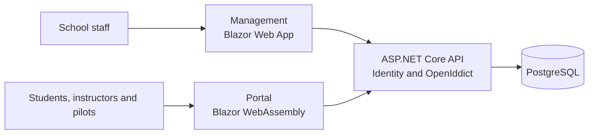

# AreoLog

**A flight school management platform in development.**

AreoLog is a software-as-a-service (SaaS) project for general aviation, initially focused on small and medium-sized European flight schools. Its goal is to bring scheduling, school administration, training, and flight operations together in one place.

This repository is a public showcase of the project. The application source code is maintained in a separate private repository.

## The idea

Running a flight school involves coordinating aircraft, instructors, students, schedules, and records. These activities are often spread across several tools. AreoLog aims to make day-to-day operations easier by connecting them in a single platform.

The project is designed around two applications:

- **Management** for school owners, administrators, and operational staff.
- **Portal** for students, instructors, pilots, and aircraft owners.

One user account can belong to multiple organizations. Each organization needs appropriate access controls for its own data; that security work remains an active development priority.

## Current progress

AreoLog is in an early development stage. The foundation and the initial identity and organization functionality have been implemented and verified locally.

**Implemented so far:**

- Account registration, email confirmation, sign-in and sign-out, password recovery, and password changes.
- Organization creation, an initial owner membership, organization selection, and invitations.
- PostgreSQL persistence with Entity Framework Core migrations.
- Authentication for Management and Portal using OpenID Connect and Authorization Code with PKCE.
- Automated tests for account and organization workflows, database integration, and existing security restrictions.

Management and Portal currently provide early interfaces and authentication flows; they are not yet complete school management applications. Aircraft persistence exists, but aircraft API operations are disabled until tenant-aware authorization is in place. The platform is not production-ready.

## Technology

- **Language and platform:** C# and .NET 10
- **Backend:** ASP.NET Core Web API, ASP.NET Core Identity, and OpenIddict
- **Management:** Blazor Web App
- **Portal:** Blazor WebAssembly, with a progressive web app (PWA) foundation
- **Database:** PostgreSQL, Entity Framework Core, and Npgsql
- **Testing:** xUnit and integration tests

The application follows a modular-monolith direction: the backend is maintained as one application while its responsibilities are organized into separate areas. Shared contracts define types used across project boundaries.

## What comes next

The next development stage focuses on roles, permissions, and stronger organization-level data isolation. Later stages are intended to introduce school management, aircraft and fleet operations, booking and scheduling, pilot and instructor workflows, training records, and finance.

These capabilities are part of the product direction, not claims of completed functionality. Priorities may change as the project develops.

## Verification

The identity and organization stage was verified locally with browser checks and automated tests. A full local test run with PostgreSQL and the test email service enabled reported **27 passed, 0 failed, and 0 skipped**. These are historical development results, not a guarantee of production readiness.

## About this repository

This showcase is intended to present the project's purpose, technology, and progress. It does not contain the private application source code or a publicly runnable release.
